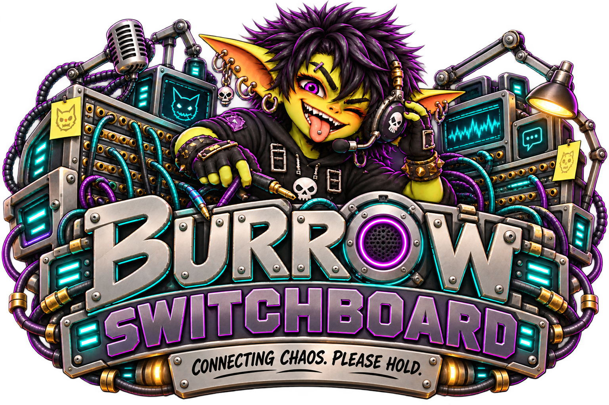

# Burrow Switchboard

**Telegram and Discord in. Goblins out.** Switchboard connects approved Telegram chats/topics and Discord DMs/channels/threads to real Burrow agent sessions. The operator chooses an agent; Core executes the turn; Switchboard returns the completed answer on the same transport.

## Current implementation

Telegram supports text and inbound photos or PNG/JPEG/GIF/WebP image documents; Discord supports text. Image turns require a compatible Core and image-capable model. Telegram uses outbound long polling; Discord uses an outbound Gateway WebSocket and REST. Neither uses an inbound webhook or requires a public reverse-proxy route. Telegram groups are approved once per bot with isolated topic sessions; Discord servers are authorized once with isolated channel/thread sessions. DMs retain admission. Telegram group speech broadcasts unless a known bot is addressed; Discord guild messages still require a human mention/reply. Settings has three workspaces sharing the selected bot: **Configuration** for credentials and bot defaults, **Pending admissions** for requests, and **Chat mappings** for approved access; historical work and delivery outcomes are under **Archive → Mods → Switchboard**.

| Implemented | Not implemented here |
| --- | --- |
| Operator-managed Telegram polling and Discord Gateway/REST, named bot connections | Other providers or inbound webhooks |
| Per-bot group/server authorization, inherited topic/channel/thread access and explicit room mappings | Unapproved group/server access, user-level allowlists, permanent deny list |
| Core external-agent-turn submission and reconciliation | A separate model runner, tool system or Tutor capability |
| Inbound Telegram images up to 20 MiB; text answers split to provider limits; native Discord slash controls | Discord attachments, outbound images, voice, streaming replies |
| Durable bounded room context and delivery records | Unlimited audit history, manual replay or retry |

An approved group/topic or guild channel/thread is a shared route: approval is **not** a separate approval of each participant. Choose an agent whose capabilities are appropriate for everyone who can address the bot there. External messages enter the real agent pipeline; approval is not a guarantee that the message is safe or authorized for every tool action.

## Read next

- [Set up Telegram](setup.md)
- [Set up Discord and check two-bot context](discord.md)
- [Admission and routing](routing.md)
- [Settings reference](settings.md)
- [Operations and troubleshooting](operations.md)
- [Architecture and Core contract](architecture.md)
- [Mod-local API](api.md)
- [Development, verification and source map](development.md)

## Documentation history

Latest ordinary delta review: **2026-11-06**, source version **2026.11.05.2**, commit `530c28e8363b86ed0cb0ac335e741eb7eb66d9fe`. The manifest and Settings implementation now expose three workspaces: Configuration, Pending admissions and Chat mappings. Status and the direct `diagnostics` alias were removed; their live diagnostic content was not moved into another workspace or Archive. Configuration still shows compact connection state and errors. This is static source reconciliation, not rendered-browser or live-provider acceptance.

Settings/Archive navigation reconciliation: **2026-11-05**, source version **2026.11.05.1**, commit `e6e2fc60584fb209b3520b3cb47fd7048daa5806`. At that dated snapshot, setup paths followed four native Settings workspaces; the 6 November review above supersedes that navigation description. Archive is historical metadata with a separate 10,000-record / 8,000,000-byte retention bound, not live diagnostics or a replay queue. This was a static source review, not a live-provider acceptance test.

Full static reconciliation: **2026-11-01**, source commit `e563ebe77e0a98b8a9b1ccc5f43f4153f1392bda`. All setup, routing, API, operations, architecture and Settings guides were checked against the current server/UI implementation. This includes the shared-host editor/guard, periodic refresh and independent Discord access/responder inheritance. Source delivery is not proof that a release is installed; the matching Settings host methods must be available. No application or live-provider tests were run during this review.

Latest delta review: **2026-10-31**, source **2026.10.30**, commit `c38709e5ef3038502757be508b79d302749658e3`: inbound Telegram images, frozen-input recovery and related diagnostics. These features require the corresponding installed Switchboard implementation plus compatible Core/model support; a healthy text route alone does not establish image support. No live provider test was performed.

Earlier full review: **2026-10-25**, source **2026.10.24.3**, commit `d1388ca8c65e250411034de7560de59d3ffdc875`. This is a source/UI contract review, not a live provider test.

The original Telegram-only documentation baseline was source version **2026.10.22.1** (commit `b12d6cb2d9aae46542c55b4da12f605ee8009b34`), inspected **2026-10-22**. This is archival provenance, **not** the current feature list or evidence of live Discord delivery. Verify installed manifest/Core compatibility rather than inferring it from a package date.

## 8 November 2026 full documentation reconciliation

All setup, routing, API, Settings, operations, architecture and development guides were statically checked against transport, connection, history and UI source. Core availability guidance now points to the diagnostic API response rather than the removed Settings panel; Discord resume identity and sequence are identified as process-local. Historical acceptance notes retain their original dates and verification limits. Reviewed source `a63337eb9b7743853e94cb6eea6ca82e7a92fd77` against Core assembly `1f77c9d0277585bfe1963ce3ab3d2cdf35f16b9a`. No application tests, live chat/provider calls, paid generation, runtime edits or skill scripts were run. Documentation checks are separate from application acceptance.
